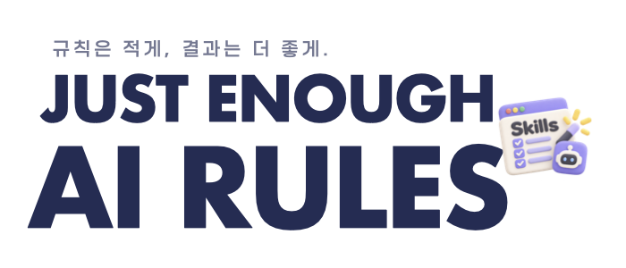

<picture>
  <source media="(prefers-color-scheme: dark)" srcset="assets/banner-ko-dark.png">
  <source media="(prefers-color-scheme: light)" srcset="assets/banner-ko-light.png">
  
</picture>

# Just Enough AI Rules (JEAR)

**같은 버그를 반복해서 수정하는 횟수는 줄이고, 다음 수정의 근거는 분명하게.**

[English](README.md)

## What is JEAR?

Just Enough AI Rules는 AI 코딩 에이전트가 근거 없이 수정 작업을 반복하지 않도록 돕는 작은 개발 규칙 모음과 선택형 디버깅 Skill입니다.

**실제 사용 결과:** AI와 제품을 개발하는 과정에서 이 방식을 적용한 뒤, 같은 오류를 여러 차례 수정하는 일이 눈에 띄게 줄었습니다. 추측으로 패치를 추가하기보다 실제 실패한 지점을 먼저 확인하도록 작업 방식이 달라졌습니다.

별도의 프레임워크나 서버, 오케스트레이터는 필요하지 않습니다.

## Why it helps

### Before & After: 같은 오류, 다른 디버깅 방식

**상황:** API 테스트는 통과하지만 버튼을 클릭해도 아무 반응이 없습니다.

| | Before: 추측하고 수정 | After: 증거를 확인하고 수정 |
| --- | --- | --- |
| 첫 판단 | "API 응답 처리가 잘못됐을 겁니다." | "버튼 클릭 시 실제 요청이 발생하나요?" |
| 다음 행동 | 추측을 근거로 API 코드 변경 | 클릭 이벤트·요청·응답·화면 경로 확인 |
| 오류가 계속된다면 | 다른 부분을 다시 추측해 수정 | 현재 가설이 틀렸음을 확인할 테스트 수행 |
| 완료 기준 | 테스트 명령이 PASS | 원래 버튼 동작을 같은 조건에서 재확인 |

**아래 대화는 동작 차이를 설명하기 위한 가상 예시이며, 실제 대화 기록이나 실험 수치는 아닙니다.**

```text
Before
AI: "API가 의심됩니다. 응답 처리를 수정하겠습니다."
사용자: "여전히 작동하지 않습니다."
AI: "이번에는 상태 관리 코드를 바꿔보겠습니다."

After
AI: "API 테스트는 통과했지만 클릭 요청이 실제로 전달되는지는
     확인하지 않았습니다. 코드를 수정하기 전에 호출 경로부터 보겠습니다."
AI: "실패 지점을 확인했습니다. 해당 부분만 수정한 뒤
     원래 버튼 동작을 같은 조건에서 재검증하겠습니다."
```

JEAR의 목적은 모든 버그를 더 빠르게 해결한다고 보장하는 것이 아닙니다. **확인하지 않은 원인을 계속 수정하느라 낭비하는 작업을 줄이는 것**입니다.

## When to use it

| 상황 | 사용 목적 |
| --- | --- |
| **반복되는 수정 실패** | 같은 오류를 계속 추측으로 수정하지 않도록 중단하고 가설 검증 |
| **거짓 테스트 성공** | 통과한 테스트와 실제 사용자 경로의 실패를 구분 |
| **실행 환경 불일치** | 다른 프로세스·환경·배포 버전을 조사하는 실수 방지 |
| **여러 단계에 걸친 오류·간헐적 장애** | 실제 호출 경로와 비동기 상태를 추적하고 증거를 보존 |

원인과 수정 방법이 명확한 작은 버그나 일반 기능 구현에는 전체 디버깅 절차를 적용할 필요가 없습니다.

## Getting Started

### 1. 기본 규칙 적용

다음 네 파일을 프로젝트 루트에 복사합니다.

| 파일 | 역할 |
| --- | --- |
| [`AGENTS.md`](AGENTS.md) | 에이전트의 작업·검증·중단 규칙 |
| [`PRODUCT.md`](PRODUCT.md) | 제품의 목표와 제약 |
| [`CURRENT.md`](CURRENT.md) | 현재 상태와 다음 검증 질문 |
| [`ARCHITECTURE.md`](ARCHITECTURE.md) | 기존 코드의 책임과 구조적 경계 |

`TODO:` 항목과 실제 테스트·린트 명령을 채웁니다. 기존 `AGENTS.md`가 있다면 **덮어쓰지 말고 합칩니다**. Debugging Skill이 참조하므로 `AGENTS.md`의 1~7절 번호는 유지합니다.

**Claude Code:** v2.1.277 이상에서는 기본 설정상 프로젝트 또는 상위 경로에 `CLAUDE.md`, `.claude/CLAUDE.md`, `CLAUDE.local.md`가 없으면 `AGENTS.md`를 자동으로 읽습니다. 반면 이 파일 중 하나라도 있으면 기본적으로 `AGENTS.md` 대신 해당 Claude 지침 파일을 사용합니다. 이때는 프로젝트 루트의 `CLAUDE.md`에 다음 한 줄을 추가해 `AGENTS.md`를 가져옵니다. 파일이 없으면 생성하되, 기존 내용은 덮어쓰지 않습니다.

```markdown
@AGENTS.md
```

`.claude/CLAUDE.md`에 추가할 때는 가져오기 경로가 그 파일을 기준으로 하므로 `@../AGENTS.md`를 사용합니다. 구버전이나 자동 로딩이 지원되지 않는 환경에서도 같은 가져오기 방식을 사용할 수 있습니다.

새 Claude Code 세션에서 `/context`를 실행해 **Memory files** 목록에 `AGENTS.md`가 표시되는지 확인합니다. 다른 코딩 에이전트는 해당 도구의 지침 연결 방법을 사용하며, 같은 규칙을 중복 복사하지 않습니다.

### 2. Debugging Skill 추가(선택)

Claude Code에서는 이 저장소를 내려받은 뒤, **적용하려는 프로젝트 루트**에서 Skill 파일을 복사합니다.

```bash
git clone https://github.com/kijepark/JEAR.git /path/to/JEAR
cd /path/to/your-project
mkdir -p .claude/skills/debugging
cp /path/to/JEAR/skills/debugging/SKILL.md .claude/skills/debugging/SKILL.md
```

이 Skill은 위 기본 규칙을 함께 사용하는 구조입니다. 원인이 불분명한 버그를 조사할 때 사용하고, 일상적인 기능 구현에 항상 적용하지는 않습니다. 다른 코딩 에이전트는 해당 도구의 작업별 Skill 경로를 사용합니다.

### 3. 첫 사용

```text
debugging Skill을 사용해 주세요. API 테스트는 통과하지만 버튼이
작동하지 않습니다. 코드를 수정하기 전에 클릭 요청이 API에
도달하는지 확인하고, 실제로 끊기는 지점을 찾은 뒤
근거가 확인된 부분만 수정하고 원래 동작을 재검증해 주세요.
```

선택: 구조 점검 스크립트를 프로젝트에 복사한 후 실행할 수 있습니다.

```bash
node scripts/check-project-docs.mjs
```

이 검사는 문서 구조만 확인하며 실제 기능의 정상 동작을 보장하지 않습니다. [점검 스크립트](scripts/check-project-docs.mjs)

## How it works

```text
실제 오류 관측
→ 반증 가능한 가설 검증
→ 근거가 확인된 최소 수정
→ 같은 조건에서 원래 증상 재확인
```

기본 규칙은 기존 코드를 먼저 찾고, AI의 설명을 가설로 취급하며, 실제로 무엇을 테스트했는지 확인하도록 합니다. 새로운 증거 없이 두 차례 진전이 없으면 반증 테스트로 전환하고, 그래도 달라진 사실이 없으면 추측성 수정을 중단합니다.

안전한 조사 순서와 완료 기준은 [`skills/debugging/SKILL.md`](skills/debugging/SKILL.md) 및 [`AGENTS.md`](AGENTS.md)를 참고하세요.

## Experience & documentation

JEAR는 AI와 제품을 개발하며 반복해서 만난 버그를 직접 분석하고, 실제 작업에 도움이 됐던 대응을 누적하며 독립적으로 발전시킨 규칙입니다. 현재 개발 과정에서 확인한 가장 뚜렷한 변화는 **같은 문제를 여러 번 수정하는 시도가 줄었다는 점**입니다.

위 Before & After는 설명용 가상 예시입니다. 특정 프로젝트의 사건 기록이나 보편적인 개선율을 나타내지 않습니다. [`RULES-BENCHMARK.md`](RULES-BENCHMARK.md)를 활용해 자신의 프로젝트에서도 규칙 적용 전후를 비교할 수 있습니다.

- **기본 규칙:** [`AGENTS.md`](AGENTS.md), [`PRODUCT.md`](PRODUCT.md), [`CURRENT.md`](CURRENT.md), [`ARCHITECTURE.md`](ARCHITECTURE.md)
- **디버깅 절차:** [`skills/debugging/SKILL.md`](skills/debugging/SKILL.md)
- **검증과 점검:** [`RULES-BENCHMARK.md`](RULES-BENCHMARK.md), [`scripts/check-project-docs.mjs`](scripts/check-project-docs.mjs)
- **라이선스:** [MIT](LICENSE)

문서형 규칙은 보안 통제나 테스트·독립 검증을 대신하지 않습니다.
