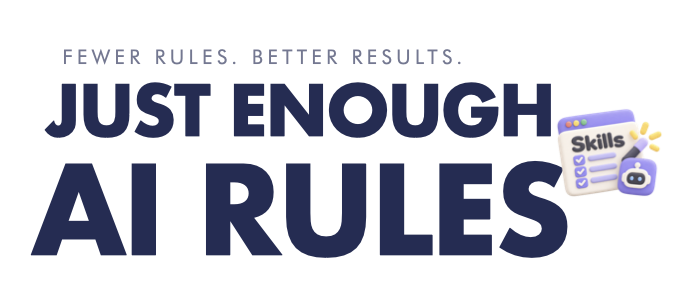

<picture>
  <source media="(prefers-color-scheme: dark)" srcset="assets/banner-en-dark.png">
  <source media="(prefers-color-scheme: light)" srcset="assets/banner-en-light.png">
  
</picture>

# Just Enough AI Rules (JEAR)

**Fewer repeated debugging attempts. More evidence before the next fix.**

[한국어](README.ko.md)

## What is JEAR?

Just Enough AI Rules is a small set of repository instructions for AI coding agents, with an optional debugging skill for failures whose causes are still unclear.

**Result from ongoing use:** While developing with coding agents, I've seen repeated debugging attempts decrease noticeably after applying these rules. Instead of repeatedly trying plausible patches, the agent checks what actually failed before changing code again.

No new framework, server, or orchestration layer is required.

## Why it helps

### Before & After: the same bug, a different response

**Scenario:** A button does nothing, even though the API tests pass.

| | Before: guess and patch | After: evidence-first debugging |
| --- | --- | --- |
| First reaction | "The API response must be wrong." | "Does clicking the button actually send a request?" |
| Next step | Edit API code based on the assumption | Observe the click, request, response, and UI path |
| If the bug remains | Try another plausible fix | Test what could disprove the current hypothesis |
| Definition of done | A test command turns green | The original user-visible behavior works under the same conditions |

**Illustrative example — not a transcript or a claimed benchmark result:**

```text
Without JEAR:
"The API looks suspicious. I'll change its response handling."
"The button still fails? I'll try changing state management."

With JEAR:
"The API tests passed, but I have not established that the click
reaches the API. I'll check that path before editing anything."
"The missing step is now identified. I'll change only that part,
then repeat the original button interaction."
```

The difference is not a promise that every bug will be solved faster. It is a practical way to avoid spending more attempts on an explanation that has not been checked.

## When to use it

| Situation | Why JEAR may help |
| --- | --- |
| **Repeated failed fixes** | Stop speculative patches when the same error survives multiple attempts |
| **False-green tests** | Distinguish tests that passed from the user path that actually failed |
| **Runtime mismatch** | Identify the real process, environment, or deployed version before debugging |
| **Multi-step or intermittent failures** | Trace calls across components and preserve timing/state evidence before retrying or restarting |

For a small bug with an established cause, or ordinary feature work, keep the process lightweight.

## Getting Started

### 1. Add the core rules

Copy these four files to your repository root:

| File | What it keeps clear |
| --- | --- |
| [`AGENTS.md`](AGENTS.md) | How the agent should work, verify, and stop |
| [`PRODUCT.md`](PRODUCT.md) | Product goals and boundaries |
| [`CURRENT.md`](CURRENT.md) | Current state and the next verifiable question |
| [`ARCHITECTURE.md`](ARCHITECTURE.md) | Existing ownership and architectural constraints |

Fill in the `TODO:` placeholders, including your actual test and lint commands. If you already have an `AGENTS.md`, **merge rather than overwrite it**. Keep its numbered sections 1–7 because the debugging skill refers to them.

**Claude Code:** It loads `CLAUDE.md`, not `AGENTS.md` directly. In the target project's `CLAUDE.md`, add this line (create the file if absent; keep any existing instructions):

```markdown
@AGENTS.md
```

Start a new Claude Code session and check `/context` to confirm `CLAUDE.md` is loaded. Other coding agents should use their supported repository-instruction mechanism; avoid duplicating the same rules.

### 2. Add the optional Debugging Skill

For Claude Code, from your **target project's root**, after checking out this repository locally:

```bash
mkdir -p .claude/skills/debugging
cp /path/to/just-enough-ai-rules/skills/debugging/SKILL.md .claude/skills/debugging/SKILL.md
```

The debugging skill builds on the core rules above. Use it for uncertain failures, not as an always-on procedure for routine implementation. For other agents, use their supported task-specific skill location.

### 3. Try it on a real bug

```text
Use the debugging skill. The button does nothing, but API tests pass.
Before changing code, check whether the click reaches the API,
identify where the actual flow breaks, and verify the original
behavior after the smallest supported fix.
```

Optional documentation check (after copying the script into your project):

```bash
node scripts/check-project-docs.mjs
```

This checks document structure, not software correctness. See [the checker](scripts/check-project-docs.mjs).

## How it works

```text
Observe the actual failure
→ Test a hypothesis that could be wrong
→ Make the smallest supported change
→ Verify the original symptom under the same conditions
```

The core rules say to search for existing code before adding more, treat explanations as hypotheses, and avoid claiming a test passed without checking what it exercised. If two attempts make no progress, switch to a falsifying test; if no new evidence appears, stop rather than blindly patch again.

The full procedures, safe escalation path, and verification criteria are in [`skills/debugging/SKILL.md`](skills/debugging/SKILL.md) and [`AGENTS.md`](AGENTS.md).

## Experience & documentation

JEAR grew independently from investigating recurring bugs during AI-assisted product development. I kept the responses that worked in day-to-day use and removed unnecessary process. The most noticeable change in my ongoing work has been **fewer repeated attempts to fix the same problem**.

The Before & After example above is illustrative. It is not a record of an identifiable incident, and no universal percentage improvement is claimed. You can evaluate the rules against your own work using [`RULES-BENCHMARK.md`](RULES-BENCHMARK.md).

- **Rules:** [`AGENTS.md`](AGENTS.md), [`PRODUCT.md`](PRODUCT.md), [`CURRENT.md`](CURRENT.md), [`ARCHITECTURE.md`](ARCHITECTURE.md)
- **Debugging workflow:** [`skills/debugging/SKILL.md`](skills/debugging/SKILL.md)
- **Evaluation and structural check:** [`RULES-BENCHMARK.md`](RULES-BENCHMARK.md), [`scripts/check-project-docs.mjs`](scripts/check-project-docs.mjs)
- **License:** [MIT](LICENSE)

These are working instructions, not a security boundary or a substitute for tests and independent verification.
